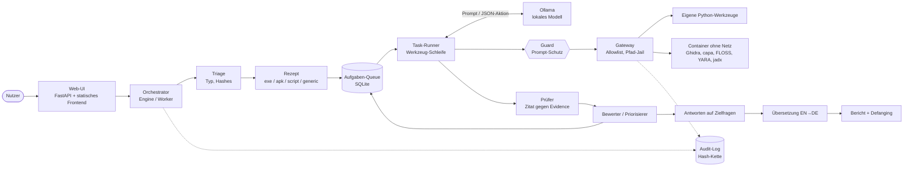
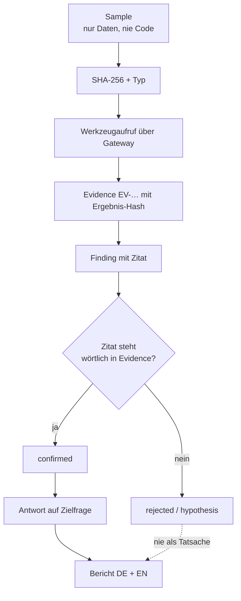
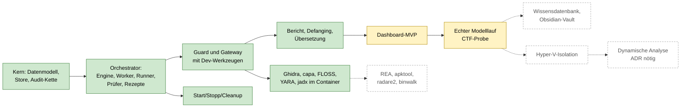

# sw-analyst

Lokale, offline lauffähige KI-Plattform zur **statischen** Analyse unbekannter Software (Windows-EXE, Android-APK, Skripte). Sie nimmt eine Datei entgegen, analysiert sie **ohne sie auszuführen** und schreibt einen belegten Bericht. Zielfragen des Nutzers werden garantiert beantwortet, danach wird schrittweise erweitert.

> **Status: Vorabversion (v0.1, in Entwicklung).** Der Kern läuft und ist getestet. Ghidra, capa, FLOSS, YARA und jadx laufen in offline Containern. Wissensdatenbank, Hyper-V-Isolation und dynamische Analyse sind noch offen (siehe [Umsetzungsstand](#umsetzungsstand)). Aktueller Stand pro Aufgabe: [`docs/STATUS.md`](docs/STATUS.md).

## Was das Projekt können soll

- Datei hochladen, Fokus und Pflichtfragen angeben, Live-Status verfolgen, Bericht abrufen.
- Dateityp erkennen, passendes **Rezept** laden (EXE, APK, Skript, generisch), Aufgaben automatisch zerlegen und abarbeiten.
- **Keine Aussage ohne Beleg:** Jedes Ergebnis nennt Evidence-ID und wörtliches Zitat. Der Prüfer vergleicht das Zitat mit dem gespeicherten Werkzeugergebnis, sonst wird die Aussage verworfen.
- Vollständig lokal: Modell über Ollama auf der eigenen GPU, keine Cloud, keine Netzwerkzugriffe zur Laufzeit.
- Lückenanalyse und Folgeaufgaben, bis alle Zielfragen beantwortet sind oder das Budget erschöpft ist (dann Status `partial` mit Begründung).
- Bericht auf Deutsch, Denken und Belegen auf Englisch; IOCs im Bericht entschärft (Defanging).

**Nicht-Ziele:** keine Exploit-Entwicklung, keine Weiterverbreitung, keine echte Malware im Repository oder auf dem Entwicklungsrechner. Dynamische Analyse ist nur als Entwurf ([ADR-0005](docs/adr/0005-dynamische-analyse.md)) vorhanden und deaktiviert.

## Architektur



Datenfluss vom Sample bis zum Bericht:



## Technik

| Bereich | Umsetzung |
|---|---|
| Sprache, Laufzeit | Python ≥ 3.11 (`src/sw_analyst/`) |
| API / UI | FastAPI, Uvicorn, SSE; Frontend in reinem JavaScript ohne Build-Schritt (`webui/static/`) |
| Datenhaltung | SQLite-Store, hash-verketteter Audit-Log (`common/`) |
| Modell | Ollama (lokal, Port 11435), Modell per `infra/manifest.json` gepinnt; austauschbarer Client, `ScriptedLLM` für Tests |
| Orchestrator | Engine, Worker, Task-Runner, Prüfer, Rezepte als YAML (`orchestrator/`, `recipes/`) |
| Sicherheit | Guard (Scanner, Sanitizer, Aktions-Validierung), Gateway mit Allowlist und Pfad-Jail (`guard/`, `gateway/`) |
| Analyse-Werkzeuge | 17 eigene Python-Werkzeuge im Gateway, dazu 9 Werkzeuge in gepinnten Docker-Images ([Liste](#werkzeuge)) |
| Bericht | Markdown-Bericht, Defanging, Übersetzung mit Glossar und Cache (`report/`, `translate/`) |
| Betrieb | PowerShell-Skripte `scripts/start.ps1`, `stop.ps1`, `cleanup.ps1`; Installation nur aus gepinnten, gehashten Quellen |
| Abhängigkeiten | `requirements.lock` mit `--require-hashes`, Wheelhouse in `vendor/` |

Verzeichnisse: `src/` Code · `tests/` Tests · `docs/` Architektur, ADRs, Blueprint, Sicherheit · `infra/` Manifest, Prüfskripte, Werkzeug-Images · `scripts/` Start/Stopp · `example/` Beispielfälle zum Evaluieren.

## Werkzeuge

Das Modell erreicht nur diese Allowlist ([ADR-0006](docs/adr/0006-statische-werkzeuge-allowlist.md)). Alle Werkzeuge lesen nur, keines startet die Probe.

| Bereich | Werkzeuge | Läuft |
|---|---|---|
| Datei | `sample_info`, `hash_file`, `identify_type`, `entropy_map`, `strings_extract`, `hexdump`, `read_lines`, `grep` | Python |
| Skripte, Dekodieren | `script_detect`, `decode_layer` (Base64, Base32, Base85, Hex, URL, ROT13, Zeichencodes, XOR, RC4, gzip, zlib), `extract_range` | Python |
| PE | `pe_headers`, `pe_resources` | Python |
| ZIP, APK | `zip_list`, `zip_read_text`, `zip_extract`, `apk_manifest` | Python |
| Code | `list_functions`, `disassemble`, `decompile`, `xrefs`, `basic_blocks` | Container: Ghidra 12.1.4 |
| Fähigkeiten, Strings | `capa_scan`, `yara_scan`, `floss_decode` | Container: capa 10.0.0, yara-x 1.22.1, FLOSS 3.2.0 |
| Android-Code | `jadx_decompile` | Container: jadx 1.5.6 |

Treffer von capa und YARA gelten als Hypothese, bis Code sie belegt. Ohne Docker oder ohne gebaute Images fehlen die Container-Werkzeuge in der Allowlist, und die Plattform läuft mit den Python-Werkzeugen weiter.

**MCP:** Das Gateway ist eine interne Allowlist in Python, kein MCP-Server. Deshalb gibt es keine `.mcp.json`, und Fremdwerkzeuge sind bewusst nicht direkt für KI-Clients eingetragen, weil sie sonst am Gateway vorbei auf dem Host liefen. Noch nicht eingebunden: REA (zurückgestellt), apktool, radare2, binwalk.

## Sicherheitsmodell

1. **Sample = Daten, nie Code.** Kein Werkzeug startet es.
2. **Prompt-Schutz.** Alles aus dem Sample steht im Prompt nur in `<untrusted_data>`-Blöcken; Anweisungsmuster werden geschwärzt, Modellaktionen gegen Schema und Allowlist geprüft.
3. **Gateway statt Shell.** Feste Werkzeug-Allowlist, validierte Argumente, Pfad-Jail, Limits. Kein `run_command`, `eval`, `exec`, `shell=True`.
4. **Belegzwang.** Antworten beruhen nur auf `confirmed` Findings.
5. **Audit-Kette.** Jeder Aufruf wird hash-verkettet protokolliert; Manipulation ist prüfbar.
6. **Aufräumen.** Start und Stopp entfernen nur eigene Prozesse, Scratch-Dateien und mit `sw-analyst` gelabelte Docker-Objekte.
7. **Container.** Fremdwerkzeuge laufen mit `--network none`, read-only, `--cap-drop ALL`, ohne Root und ohne Hostmount, mit Speicher-, CPU- und Prozesslimit. Die Probe kommt über stdin in ein `noexec`-tmpfs. Kein Modelltext erreicht den Container.
8. **Geplant:** echte Proben nur in einer Hyper-V-VM ohne Netzwerkkarte. Die Container auf dem Entwicklungsrechner ersetzen sie nicht, dort sind nur harmlose Proben erlaubt.

Restrisiko: Eine VM-Flucht lässt sich nie ganz ausschließen. Echte Schadsoftware gehört auf einen dedizierten Rechner ohne Anbindung an Produktivnetze. Details: [`PROJEKTPLAN.md`](PROJEKTPLAN.md) Abschnitt 2.

## Umsetzungsstand

Belegt durch Tests (982 Tests, alle grün: Unit, Sicherheit, forensische Kettenprüfung, CTF-Kette mit Skript-Modell). Der erste Lauf mit echtem Modell im Browser steht noch aus.



| Stand | Inhalt |
|---|---|
| Fertig | Kern, Orchestrator, Guard, Dev-Gateway, Container-Werkzeuge (ADR-0006), Bericht und Defanging, Übersetzung, Start/Stopp/Cleanup, Tests |
| Teilweise | Dashboard (Übersicht, Beispiele, Auftrag mit Aktivität, Baum, Queue, Code, Datei mit Hex/Assembler/Pseudocode, Log, Schutz, Bericht, Export/Import; Diagramme offen; Browserlauf nur mit Skript-Modell geprüft), erster echter Modelllauf; Container-Werkzeuge sind einzeln getestet, aber noch nicht in einem Modelllauf gemessen |
| Offen | REA (zurückgestellt), apktool, radare2, binwalk, Wissensdatenbank, Obsidian-Vault-Writer, Hyper-V-VM, forensische Testblöcke, Modell-Benchmark |
| Nur Entwurf | Dynamische Analyse (braucht ADR-0005 und ausdrückliche Freigabe) |

## Voraussetzungen

- Windows 11
- Python 3.11: `winget install --id Python.Python.3.11 --exact`
- uv (optional, schneller als pip): `winget install --id astral-sh.uv --exact`
- Git: `winget install --id Git.Git --exact`
- Docker Desktop (optional, nur für die Container-Werkzeuge): `winget install --id Docker.DockerDesktop --exact`
- Ollama installiert `start.ps1` selbst in der gepinnten Version mit Hash-Prüfung
- NVIDIA-GPU mit 16 GB VRAM (Entwicklung auf RTX 5060 Ti), Limit 24 GB RAM für WSL/Docker/Modelle zusammen
- Kein Administratorrecht für den Normalbetrieb (Hyper-V-Einrichtung später schon)

## Schnellstart

Linux-Live-Host über Ventoy (ADR-0013, Einrichtung in [`docs/runbooks/linux-ventoy.md`](docs/runbooks/linux-ventoy.md)):

```bash
scripts/start.sh --setup   # einmalig online: venv, Ollama, Modell und Tool-Images aus den Pins
sudo sw-mode offline
scripts/start.sh           # startet nur offline; Strg+C oder scripts/stop.sh beendet alles
```

Windows:

```powershell
scripts\start.ps1          # prüft, installiert aus Pins, startet Ollama und App, öffnet das Dashboard
scripts\stop.ps1           # beendet alles und räumt eigene Reste auf
```

Was `start.ps1` selbst installiert: `.venv` mit `requirements.lock`, Ollama und das Chat-Modell. Das Embedding-Modell nennt es nur, weil erst die geplante Wissensdatenbank es braucht. Für fehlende Programme, die es nicht selbst installieren kann, nennt es im Log den Befehl. `infra\verify-prereqs.ps1` prüft alle Voraussetzungen, ohne etwas zu ändern.

Container-Werkzeuge einmalig bauen (Docker muss laufen, Netz nötig, ca. 3 GB, bis zu 10 Minuten):

```powershell
scripts\start.ps1               # baut fehlende Tool-Images selbst (-NoBuild lässt das aus); von Hand: infra\tools\build-images.ps1
```

Schalter `start.ps1`: `-NoCleanup`, `-Offline`, `-Update`, `-SkipUpdateCheck`, `-NoBrowser`, `-BuildTools`, `-Model`, `-Port`, `-OllamaPort`.
Tests: einmalig `uv pip install --python .venv\Scripts\python.exe --require-hashes -r requirements-dev.lock`, dann `.venv\Scripts\python.exe -m pytest`. Die Tests der echten Images werden ohne Docker übersprungen. Beispielfälle mit automatischer Prüfung des Berichts: `example\start_eval.ps1` (Menü, siehe [`example/README.md`](example/README.md)).

## Weiterlesen

- [`docs/README.md`](docs/README.md) – Dokumentenkarte: wo steht was
- [`docs/runbooks/betrieb.md`](docs/runbooks/betrieb.md) – Start, Stopp, Ablage, Fehlerbehebung
- [`docs/runbooks/linux-ventoy.md`](docs/runbooks/linux-ventoy.md) – Linux-Live-Host über Ventoy: Einrichtung, Freigabe, Offline-Modus
- [`docs/security/sicherheitsmodell.md`](docs/security/sicherheitsmodell.md) – Schutzschichten, Tests, Restrisiko
- [`PROJEKTPLAN.md`](PROJEKTPLAN.md) – Quelle der Wahrheit (Ziele, Sicherheit, Phasen)
- [`docs/STATUS.md`](docs/STATUS.md) – aktueller Stand, offene Aufgaben
- [`docs/architecture/chain.md`](docs/architecture/chain.md) – Analysekette im Detail
- [`docs/architecture/workflows.md`](docs/architecture/workflows.md) – Start/Stopp, Job-Lebenszyklus, Schutzschichten, Datenfluss als Diagramme
- [`example/`](example/README.md) – Beispielfälle (Challenges) mit automatischer Prüfung des Berichts: `example\start_eval.ps1`
- [`docs/blueprint/`](docs/blueprint/) – Analysemethodik
- [`docs/adr/`](docs/adr/) – Entscheidungen

## Lizenz

Noch nicht festgelegt (Entscheidung von Jan offen). Bis dahin: alle Rechte vorbehalten.
