# Statusübersicht sw-analyst

Stand: 2026-11-01 · Legende: `[x]` erledigt und geprüft · `[~]` begonnen · `[ ]` offen · `[!]` blockiert, braucht Jan

## Phase P: Voraussetzungen (vor jeder Implementierung)

### P1 Inventur
- [x] Hardware: RTX 5060 Ti 16 GB (Treiber 617.42), 31,1 GB RAM, 16 Threads, D: 1,3 TB frei
- [x] Tools vorhanden: git 2.55, Python 3.11.9, Node 24.19, Docker 29.8.2 (Client), Ollama 0.35.1 (Client), JDK 17, uv, gh, WSL2 (kali-linux)
- [x] Tools fehlend: pipx (nicht nötig, uv genügt), cmake (erst bei Bedarf)
- [!] GPU: 12,3 von 16,3 GB VRAM durch Desktop-Apps belegt (Browser, Zotero, Steam-WebHelper, WhatsApp u. a.). Frei für Modelle: ca. 4 GB. Siehe Blocker B2.

### P2 Plugins und Skills (Dev-Rechner)
- [x] Caveman (655b7d9) vorhanden
- [x] graphify 0.8.44 vorhanden (CLI + Skill)
- [x] Ponytail (96608e0) installiert. Audit: keine Netzwerkaufrufe in Hooks; Webhook nur bei Konfiguration.
- [x] claude-security, feature-dev, pr-review-toolkit, mcp-server-dev installiert (claude-plugins-official, nur On-Demand-Befehle, Hooks ohne Netzwerk)
- [x] Bereits vorhanden: engineering:* (code-review, architecture, system-design, testing-strategy, debug, documentation), security-review, code-simplifier, frontend-design
- [x] Verworfen nach Audit: mnemo (Fremd-Hooks auf jedem Tool-Call, Binary-Nachladen), security-guidance (pip-venv beim Start, LLM-Review bei jedem Stop)
- [x] Ponytail userConfig geprüft: Webhook leer (nichts verlässt den Rechner), lokales Ledger bleibt Standard
- [x] Audits mit SHAs in `docs/dev-environment.md`, Entscheidungen in `docs/adr/0000-grundentscheidungen.md`

### P3 Claude-Code-Einstellungen
- [x] Auto-Compact bei 70 % (`.claude/settings.json`)
- [x] Auto-Compact: Schlüssel `autoCompactEnabled` nicht gesetzt = Standard (an); Schwelle 70 % per Projekt-Env
- [x] Repo-Gerüst, `.gitignore`, Pre-Commit-Hook (Test: blockiert .exe in tests/corpus), CLAUDE.md, PROJEKTPLAN.md
- [x] Erster Commit (`5d5a15e`), LF-Erzwingung für Hooks (`342bae3`)

### P4 Laufzeit-Infrastruktur
- [x] Docker Desktop läuft (Engine 29.8.2), GPU-Durchreichung getestet (nvidia-smi im Container, `--network none`)
- [!] `.wslconfig` von 20 auf 24 GB: erfordert `wsl --shutdown` und beendet laufende WSL-Dienste (Kali, anderer Docker-Stack). Freigabe von Jan nötig. Siehe B1.
- [x] Ollama-Server starten, Umgebung setzen: `infra/start-ollama.ps1` (Port 11435, Loopback, Flash Attention, KV-Cache q8_0, `MAX_LOADED_MODELS=1`, `KEEP_ALIVE`); `qwen3:8b` und `qwen3:14b` installiert
- [~] Modellauswahl automatisiert: `infra/select-model.ps1` wählt nach freiem VRAM (Stufen A/B/C). Benchmark mit synthetischen Beispielen: `tests/bench/run_live.py` und `example/` (Stand der Messung siehe Modellabschnitt M0 bis M7)
- [ ] Embedding-Modell wählen und testen
- [!] Hyper-V: Dienst `vmms` läuft, Admin-Rechte fehlen für VM-Anlage. Admin-Skript wird erzeugt (Phase 1).

### P5 Analyse-Werkzeuge (Dev-Test mit harmlosen Proben)
- [x] Ghidra: 12.1.4 mit JDK 21 gepinnt, Image `sw-analyst/ghidra:12.1.4` gebaut, Lauf mit harmloser Probe grün (ADR-0006)
- [~] REA: von Jan freigegeben (nur statisch, ohne Live-Teile). Tiefenaudit fertig (6.8.0, Pin, Familien- und Tool-Allowlist, Auflagen in dev-environment.md). Einbau ins Docker-Image und manuelles Quellcode-Review stehen aus.
- [ ] jadx, apktool, capa, YARA, FLOSS, radare2, binwalk, pefile, lief, androguard im Image
- [x] Ghidra-MCP: entfällt, `analyzeHeadless` mit festem Export statt pyghidra-mcp; MCP bleibt intern, keine `.mcp.json` (Entscheidung von Jan, ADR-0006)
- [~] Alle Downloads mit SHA-256 in `docs/dev-environment.md`: erfasst, Lücken stehen unter „Weitere Tests aus dem Plan“

### P6 Abschluss Voraussetzungen
- [x] Verifikationsskript `infra/verify-prereqs.ps1` (Lauf: 24 PASS, 2 FAIL: VRAM, Ollama-Server; 2 WARN: freier RAM, graphify-out)
- [x] Kompakte Doku `docs/README.md` (Dokumentenkarte, Entscheidungen, Begriffe), dazu `docs/runbooks/betrieb.md` und `docs/security/sicherheitsmodell.md` (2026-10-31)
- [x] graphify-Lauf über das Repo, `graphify-out/` vorhanden
- [ ] Freigabe von Jan für Phase 0

## Blocker und offene Fragen an Jan
- B1: `wsl --shutdown` zum Anwenden des 24-GB-Limits erlaubt? (beendet WSL-Instanzen, auch andere Projekte)
- B2: VRAM-Belegung durch Desktop-Apps: Apps schließen oder kleineres Modell akzeptieren?
- B4: Freier RAM beim Test nur 3,7 von 31 GB (Docker Desktop frisch gestartet plus Browser/Apps). 24-GB-Limit ist nur realistisch, wenn andere Programme während der Analyse geschlossen sind.
- B5: erledigt. Jan hat REA ohne Live-Komponenten freigegeben, Bedingungen im Audit.
- B3: Admin-Rechte für Hyper-V-Einrichtung: Du führst das erzeugte Skript selbst aus (bestätigt in Auswahl, Termin offen).

## Aktuelle Arbeit (feat/core-chain)
- [x] Kern: Datenmodell, Gateway-/LLM-Vertrag, Audit-Log (Hash-Kette), SQLite-Store, Ollama-/Fake-Client mit Tests (korrigiert 2026-10-31)
- [x] Dev-Gateway, Prompt-Schutz, Übersetzung und Defanging liegen mit Tests vor (korrigiert 2026-10-31). Frontend: siehe „Dashboard-Lücken“.
- [x] Blueprint (docs/blueprint/, Dateien 00 bis 15) liegt vor (korrigiert 2026-10-31)
- [x] Audit morluto/rea fertig, Auflagen in `docs/dev-environment.md` (korrigiert 2026-10-31)
- [x] Orchestrator: Prompt-Registry, Rezepte, Prüfer, Task-Runner, Evaluator, Priorisierer, Planer, Engine, Worker, Report-Builder, API und CTF-Tests liegen vor (korrigiert 2026-10-31, der Eintrag war veraltet)
- [x] graphify-Lauf über das Repo; `graphify-out/` liegt vor, Post-Commit-Hook hält den Graphen aktuell

## Hinweis Limit (2026-10-31)
Sitzung wegen Nutzungslimit beendet. Der Frontend-Agent wurde gestoppt (vorhanden: api.js, dom.js, markdown.js, theme.js, mock.js; es fehlen index.html, app.js, styles.css und der Asset-Test). Hintergrund-Agenten (Dev-Gateway, Dev-Gateway, Prompt-Schutz, Übersetzung, 4 Blueprint-Agenten, REA-Audit, graphify-Extraktion) laufen eventuell weiter und schreiben Dateien. Ergebnisse prüfen: `git status`, dann Tests (`.venv\Scripts\python.exe -m pytest`). graphify: Chunk-Datei `graphify-out/.graphify_chunk_01.json` abwarten, dann Schritte 3 Part C bis 9 des Skills ausführen (AST-Ergebnis liegt in `graphify-out/.graphify_ast.json`).

## Nächste Schritte: alles zum Laufen bringen (Priorität 1, Stand 2026-10-31 abends)
Ziel: ein echter Job läuft im Browser mit echtem Modell von der Eingabe bis zum Bericht, gestartet mit `scripts\start.ps1`.
Abnahme: CTF-Probe (zwei Base64-Schichten, Flagge) wird mit lokalem Modell gelöst, Antwort belegt und als erwartet erkannt; Dashboard zeigt Aktivität, Baum, Queue, Live-Bericht und Log; `stop.ps1` beendet sauber.

| # | Schritt | Ergebnis | Abhängig von |
|---|---|---|---|
| R1 | Arbeitsbaum sichern: Startskripte, Preflight, Fable-Dokumente committen und pushen, `git ls-files -d` prüfen | Stand auf GitHub | nichts |
| R2 | Modell: `qwen3:8b` (existiert sicher, Thinking und Tools) in `D:\Tools\sw-analyst\ollama-models` ziehen, Server auf Port 11435 starten, Smoke-Test JSON-Modus, Geschwindigkeit messen. Parallel prüfen, ob `gemma4:12b-it-q4_K_M` und `ornith:9b-q4_K_M` existieren (VRAM jetzt ca. 14 GB frei) | Modellwahl belegt, ADR-0001 aktualisiert | nichts |
| R3 | Backend-Lauffähigkeit: Origin-Prüfung portabel machen (nicht fest 8765), Endpunkt `/activity`, Antwortbudget für Thinking-Modelle anheben und leere Antworten abfangen, `redact`/Guard im echten Lauf prüfen | `python -m sw_analyst` startet, API antwortet | R2 |
| R4 | Frontend-MVP fertigstellen (Neuer Auftrag, Aktivität, Baum, Queue, Live-Bericht, Log, Bericht), dann Asset-Test | Dashboard bedienbar, `?mock=1` zeigt alle Ansichten | R3 (API-Form) |
| R5 | Erster echter Lauf: CTF-Probe über den Browser, Fehler in Prompts und Schleife beheben (JSON-Zuverlässigkeit, Token, Dauer), danach Skript mit 3 Schichten und kleine synthetische PE | belegte Antwort, Messwerte je Aufgabe | R2 bis R4 |
| R6 | `start.ps1` und `stop.ps1` scharf testen (CHECK, INSTALL aus Pins, OLLAMA, APP, Strg+C, `-Force`) | ein Befehl startet alles | R2, R3 |
| R7 | Abnahme: alle Tests grün, `/claude-security` auf dem Diff, Tag `v0.1.0`, `feat/*` per `--no-ff` nach `main`, Push | lauffähiger `main` | R1 bis R6 |

Danach (Priorität 2, in dieser Reihenfolge): P1-Anpassungen aus `docs/review/platform-adjustments.md` (Guard-Schema, Store-Tabellen, Endpunkte, Antwortbudget), forensische Tests Block 1 und 2, Dashboard V2 (Lernpfad, Diagramme), Hyper-V-VM, dynamische Analyse (ADR-0005).

## Strukturierte Code-Review durch alle Modelle (von Jan beauftragt, 2026-10-31)
Ziel: Jedes verfügbare Modell prüft denselben Code nach demselben Raster. Unterschiedliche Modelle finden unterschiedliche Fehler; der Abgleich zeigt, was mehrfach bestätigt ist und was nur ein Modell sieht. Annahme: "alle Modelle" = die Claude-Modelle Fable 5.1, Opus 5.5, Sonnet 5.5, Haiku 5.5. Falls auch die lokalen Ollama-Modelle gemeint sind, bitte melden (anderer Ablauf, siehe Risiken).
Stand: **Prüfung abgeschlossen, Behebung offen** (siehe „Behebung der Review-Funde“). Reihenfolge: erst dieses Code-Review mit Behebung, danach der Security-Review (eigener Schritt, CLAUDE.md Arbeitsweise 9) und der Tag `v0.1.0` (siehe R7 und Abnahme unten).

### 1. Umfang (feste Pakete, je Paket ein Auftrag je Modell)
| Paket | Pfad | Zeilen (ca.) | Schwerpunkt |
|---|---|---|---|
| A Kern | `src/sw_analyst/common/` | 600 | Audit-Hash-Kette, Store, Datenmodell, Zeitstempel |
| B Gateway | `src/sw_analyst/gateway/` | 2150 | Allowlist, Pfad-Jail, Regex-Guard (ReDoS), Parser-Robustheit |
| C Guard | `src/sw_analyst/guard/` | 1500 | Prompt-Injection-Regeln, Umgehung (Unicode, Kodierung), Aktions-Validierung |
| D Orchestrator | `src/sw_analyst/orchestrator/`, `prompts/`, `recipes/` | 1050 | Schleife, Budget, Belegprüfung (Verifier), Abbruch, Races im Worker |
| E LLM und Übersetzung | `src/sw_analyst/llm/`, `translate/` | 850 | Fehlerbehandlung, leere Antworten, Protect/Restore, Cache |
| F Bericht | `src/sw_analyst/report/` | 390 | Defanging-Lücken, Evidence-Bezug, Reproduzierbarkeit |
| G Web | `src/sw_analyst/webui/` (Python und `static/*.js`) | 350 + JS | Upload, Origin-Prüfung, XSS, Pfade, SSE |
| H Betrieb | `scripts/*.ps1`, `infra/` | - | Löschumfang von Cleanup, Pins/Hashes, Fremdprozesse |
| I Tests | `tests/` | - | Lücken gegen `docs/testing/forensic-test-plan.md`, Schein-Tests |

### 2. Raster (jedes Modell prüft jedes Paket nach denselben 8 Punkten)
1. Korrektheit und Logikfehler, Randfälle
2. Sicherheit: Pfad-Traversal, Injection, Prompt-Injection über Sample-Inhalte, Rechte, Secret-Leaks
3. Forensik: Chain-of-Custody, Hashes, Determinismus, Zeitstempel
4. Belegzwang: kann eine Aussage ohne passende Evidence durchrutschen?
5. Ressourcen: Limits, Timeouts, Endlosschleifen, Speicher
6. Fehlerbehandlung: stille Fehler, Fallbacks, die Fehler verdecken
7. Tests: Abdeckung, Schein-Tests, fehlende Negativfälle
8. Vereinfachung: überflüssiger Code, doppelte Logik (Ponytail-Prinzip)

### 3. Verteilung der Modelle
| Modell | Rolle | Pakete | Hinweis |
|---|---|---|---|
| Fable 5.1 | Tiefenprüfung Architektur und Sicherheit | B, C, D (Verifier), F | stärkstes Modell nur dort, wo Sicherheit zählt (CLAUDE.md Subagenten-Regel 2) |
| Opus 5.5 | Zweitmeinung Sicherheit und Logik | alle A bis G | unabhängig, ohne Fable-Ergebnis lesen |
| Sonnet 5.5 | Breite Prüfung aller Pakete | A bis I | Standardrunde |
| Haiku 5.5 | schnelle mechanische Prüfung | G (JS), H, I | Lint-nahe Funde, Stil, tote Pfade |
Jedes Modell prüft **blind** (kein Zugriff auf die Ergebnisse der anderen), danach erst Abgleich.

### 4. Ablauf
1. Auftrag je Modell und Paket nach Regeln in CLAUDE.md "Subagenten-Regeln": Prompt unter 40 Zeilen, `graphify` zuerst, feste Dateimenge, nichts committen, Abgabe höchstens 25 Zeilen mit graphify-Nachweis.
2. Ausgabeformat je Fund (eine Zeile, maschinenlesbar): `paket | datei:zeile | schwere (krit/hoch/mittel/niedrig) | kategorie (1-8) | problem | fix | konfidenz`.
3. Ablage: `docs/review/code-review/<modell>-<paket>.md`.
4. Abgleich durch den Hauptagenten: `docs/review/code-review/SUMMARY.md` mit Tabelle Fund x Modell (bestätigt = mindestens 2 Modelle, einzeln = 1 Modell, widersprüchlich).
5. Jeder bestätigte Fund mit Schwere hoch oder kritisch wird vor dem Beheben mit einem Test reproduziert. Einzelfunde werden gelesen und bewertet, nicht blind übernommen.
6. Behebung in `fix/review-<paket>`, je Paket ein Merge nach grünen Tests. Offene Funde mit Begründung nach `docs/STATUS.md`.

### 5. Abnahme
- [x] Alle 9 Pakete von mindestens 2 Modellen geprüft (2026-10-31, 11 Berichte, 289 Funde, Haiku nur G, H, I wie vorgesehen)
- [x] `docs/review/code-review/SUMMARY.md` mit Fund-x-Modell-Tabelle, Funde getrennt in bestätigt (23, davon 1 kritisch, 12 hoch), einzeln, verworfen (mit Grund)
- [ ] Alle kritischen und hohen bestätigten Funde behoben, je mit Test (F-01 bis F-13 in SUMMARY.md, noch nichts behoben; F-07 und F-08 brauchen ADR und Freigabe von Jan)
- [ ] Tests grün, Ergebnis in `docs/STATUS.md` und im Dev-Vault
- [ ] Danach erst Security-Review (`/claude-security`) und Tag `v0.1.0`

### 6. Risiken
- Token-Kosten: Opus und Fable nur auf B, C, D, F voll; Rest über Sonnet/Haiku. Reihenfolge: Sonnet breit, dann gezielte Tiefenprüfung dort, wo Sonnet Funde meldet.
- Halluzinierte Funde: jeder Fund braucht Datei, Zeile und Reproduktion; ohne das gilt er als unbelegt.
- Prompt-Injection über Testproben: Prüfer lesen `tests/corpus/` nur über Manifest, nie Probeninhalte als Anweisung.
- Lokale Ollama-Modelle (`qwen3:8b` u. a.) taugen für diese Prüfung kaum (siehe `docs/review/model-evaluation.md`); nur auf ausdrücklichen Wunsch, dann mit kleineren Paketen und Pflicht-Gegenprüfung.

## README (von Jan beauftragt, 2026-10-31)
- [x] **`README.md` im Repo-Root** (erstellt 2026-10-31; Screenshots und Flussdiagramm-Datei folgen) (fehlt, GitHub zeigt bisher keine Startseite). Inhalt: Zweck und Nicht-Ziele (nur statische Analyse, keine echte Malware im Repo), Architektur in einem Bild (Kette: Triage, Rezept, Queue, Task-Runner, Guard, Prüfer, Antworten, Bericht), Voraussetzungen (Windows 11, Python 3.11, Docker, NVIDIA-GPU, 24 GB RAM-Limit), Schnellstart (`scripts\start.ps1`, `stop.ps1`, Schalter `-NoCleanup`, `-Offline`, `-Update`), Sicherheitsmodell (Isolation, Gateway-Allowlist, Prompt-Schutz, Audit-Kette), Verweise auf `PROJEKTPLAN.md`, `docs/STATUS.md`, `docs/blueprint/`, Teststand, Lizenz. Belegt nur, was läuft; Offenes steht unter "Status". Screenshots des Dashboards erst nach dem ersten echten Lauf.

## Flussdiagramm der umgesetzten Workflows (von Jan beauftragt, 2026-10-31)
- [x] **Abstraktes Flussdiagramm** (erstellt 2026-10-31: `docs/architecture/workflows.md`, 4 Diagramme, im README verlinkt; Bild-Export für das README steht aus) (`docs/architecture/workflows.md`, Mermaid, auch als Bild im README): nur was tatsächlich umgesetzt ist, je Workflow ein Diagramm auf hoher Ebene. Vorgesehen: (1) Start/Stopp (CLEAN, CHECK, INSTALL, UPDATE, OLLAMA, MODEL, APP, Statusschleife, Stopp mit Cleanup), (2) Job-Lebenszyklus (Auftrag, Triage, Rezept, Aufgaben-Queue, Task-Runner mit Werkzeug-Schleife, Prüfer, Bewerter, Priorisierer, Antworten, Übersetzung, Bericht), (3) Schutzschichten (Guard vor und nach jedem Modellaufruf, Gateway-Jail, Audit-Kette), (4) Datenfluss Sample bis Bericht mit Hashes und Evidence. Nicht Umgesetztes (Ghidra, Wissensdatenbank, dynamische Analyse) wird gestrichelt und als "offen" markiert. Quellen: `docs/architecture/chain.md`, `scripts/start.ps1`, `orchestrator/*`; graphify-Abfragen vorab, damit das Bild dem Code entspricht und nicht dem Plan.

## Dashboard-Lücken (Stand 2026-10-31 20:15, per Screenshot geprüft)
- [x] App startete nicht: `python-multipart` fehlte (Upload-Route). Gepinnt auf 0.0.32 (Apache-2.0, 0.0.33 vom selben Tag bewusst übersprungen), Test `tests/unit/test_webui_boot.py` sichert den Start ab.
- [x] `index.html` lud drei nicht vorhandene Skripte. Behoben auf `feat/dashboard-integration` (2026-10-31): `view_log.js` (Tabs Log und Schutz) neu, tote Verweise entfernt, Test `test_every_script_and_style_in_index_html_exists`.
- [x] Layoutfehler: Das CSS für Auftragskopf, Tabs, Aktivität, Baum, Code, Schritte, Kacheln und Formulare fehlte ganz. Ergänzt in `styles.css`, per Headless-Chromium gegen das echte Backend geprüft.
- [x] Neuer Auftrag: Upload über das Formular im Browser bis zum Bericht geprüft (Playwright, Skript-Modell, 0 Konsolenfehler).

### Stand Dashboard-Nacharbeit (2026-10-31 22:30, Worktree `sw-analyst-dashboard`, Branch `feat/dashboard-start`)
Ursache der Layoutfehler: Das CSS für Auftragsansicht, Tabs, Baum, Code-Viewer, Schritte und Bericht-Karten wurde nie geschrieben (Commit `1f2940f` brachte nur JS). Behoben im Worktree: `view_log.js` (Tabs Log und Guard), tote Skript-Verweise entfernt, rund 120 Zeilen CSS, Typo "Werkzeugaufrufe", Test `test_every_script_in_index_html_is_served`. Per Headless-Edge mit Mock-Daten geprüft (Übersicht, Aktivität, Baum, Code, Guard).
- [ ] **Merge-Konflikt klären:** Eine zweite Sitzung merged `main` in `feat/dashboard-start` (Konflikte in `docs/dev-environment.md`, `example/README.md`, `example/run_eval.py`, `example/samples.py`). Erst abschließen oder abbrechen, bevor jemand dort committet.
- [ ] **Uncommittet im Worktree:** `styles.css` (neue Regeln), `view_job.js` (Typo), `tests/unit/test_webui_boot.py` (neuer Test). Einzeln committen, nicht mit dem Merge vermischen. `view_log.js` und der `index.html`-Fix sind bereits in `21f8506`.
- [ ] **4 Testfehler** in `tests/forensic/test_api_security.py` (Traversal-Fälle, `test_index_html_is_csp_clean_and_self_contained`). Datei stammt aus der anderen Sitzung. Prüfen, ob die `index.html`-Änderung die CSP-Prüfung auslöst.
- [ ] **Security-Review** der Dashboard-Änderungen (XSS über `textContent`, Pfade, CSP), Pflicht vor dem Merge nach `main`.
- [ ] **Merge `feat/dashboard-start` nach `main`** (`--no-ff`) nach grünen Tests und Review. ADR-0006 doppelt, vorher umnummerieren. Nicht pushen (siehe Punkt zum Push von `main`).
- [~] **Dashboard V2:** Diagramme (`view_diagrams.js`) seit 2026-11-01 vorhanden (Ablauf, Wissensfortschritt, Aufgabengraph, Belegfluss); Funktionsliste und Lernpfad fehlen. Backend `/diagrams`, `/functions`, `/walkthroughs` gibt es nicht.
- [ ] **Mock ohne `/activity`:** Live-Aktivität zeigt im `?mock=1`-Modus "Noch keine Daten". Mock ergänzen oder echtes Backend im Browser prüfen.
- [ ] **Echtes Backend im Browser prüfen:** Bisher nur Mock-Daten per Screenshot gesehen, Dashboard nicht gegen laufende App getestet.

## Prüfung Frontend-Backend-Anbindung (von Jan beauftragt, 2026-10-31 abends, Cloud-Sitzung)
Branch `feat/dashboard-integration` (von `main`, mit `feat/static-tools` gemergt). Entscheidungen in [ADR-0008](adr/0008-dashboard-dateiansicht-export-import.md), von Jan am 2026-11-01 freigegeben. Auf Anweisung von Jan per `--no-ff` nach `main` gemergt (2026-11-01), damit kommt auch `feat/static-tools` nach `main`. `feat/dashboard-start` liegt nur lokal bei Jan und ist nicht auf GitHub; beide Stände überschneiden sich in `webui/app.py`, `view_job.js`, `index.html` und `styles.css`.

Bestätigt (Tests und Browserlauf gegen das echte Backend mit Skript-Modell, kein Ollama in der Cloud):
- [x] Code-Viewer zeigte keine Zeilen (Vertrag `{n, text}` verletzt, Binärdateien gaben 400). Behoben, bisheriger strikter xfail aufgelöst.
- [x] Laufzeitordner: relatives `--data-dir` zählt ab Projekt-Root, alle Ordner entstehen beim Start, Temp und Upload-Spool in `data/tmp` statt `%TEMP%` (`common/paths.py`). Server aus `/tmp` gestartet legte die Ordner im Projekt an.
- [x] Beispiele im Dashboard: sortiert leicht, mittel, schwer, mit Größe, SHA-256 und Ort des Codes, Quelltext und Probe ansehbar, Start als Auftrag, Ergebnis „Flagge gefunden“. Neues Beispiel `05-pe-xor-routine` (echte x86-Schleife, per Disassembler geprüft); Beispiel 03 bytegleich.
- [x] Tab „Datei“: Größe, Art, Ablage, Hex mit Blättern, Funktionsliste, Assembler mit fester deutscher Erklärung je Befehl, Pseudocode aus dem Ghidra-Export. Ohne Image nennt er Grund und Befehl.
- [x] Export und Import (ZIP mit Manifest, Zeilen, Audit-Kette, Bericht, optional Dateien). Import prüft Prüfsummen, Kette, jedes Ereignis gegen die Kette und baut den Bericht bytegleich nach. Importe liegen schreibgeschützt in eigenem Store (`I0001-J-…`), IDs bleiben original. Manipuliertes Paket abgelehnt, Doppel-Import erkannt.
- [x] Neustart mitten im Lauf (`kill -9`): Auftrag `failed` mit Endzeit, hängende Aufgaben und Schritte geschlossen, Audit-Kette gültig, alle Daten erhalten.
- [x] Behoben aus dem Review: F-09 (Worker überlebt Engine-Fehler), F-10 (Status `uploading` bis Sample geschrieben), F-17 (`stop.ps1` Origin aus `-Port`), F-18 (fehlende Skripte), F-20 (Upload-Limit vor dem Spoolen per `Content-Length`).
- [x] Weitere Funde: Live-Logzeilen kamen ohne Stufe und Text an (`store.js`), Live-Aktivität verwarf Ereignisse während einer Abfrage, Laufzeit im Kopf zeigte „0 ms“, Spaltenköpfe „origin“/„reason“ im deutschen Bericht, `requirements-dev.lock` ohne `python-multipart`, Dateiname `..\..\x` behielt unter Linux die Pfadteile, `parse_jadx_tar` unter Python 3.12+.
- [x] Tests: 1039 grün, 10 übersprungen (Docker-Images, Windows), 37 bekannte xfails. Neu: `test_dashboard_api.py` (38), `test_bundle.py` (51), `test_worker_recovery.py` (3). Zwei bisher strikte xfails aufgelöst (Code-Viewer-Vertrag, Bidi-Zeichen im Sample-Namen).
- [x] Security-Review des Änderungsstands (eigener Schritt, unabhängiger Agent, 2026-10-31): keine kritischen oder hohen Funde, nichts führt Sample-Bytes aus. Behoben mit Test:
  - M1: GET-Routen mit Nebenwirkung (Export, Ghidra-Start) waren von fremden Seiten auslösbar. Jetzt weist `/api` Anfragen mit `Sec-Fetch-Site` außer `same-origin`/`none` und fremdem `Origin` ab.
  - M2: Markdown-Injection über Felder importierter Zeilen in den Bericht. Jetzt läuft jedes Feld durch `_tok`/`_hex`/`_cell`, Fragen-IDs sind begrenzt. Bei normalen Werten bleibt der Bericht bytegleich.
  - M3 teilweise: Cache-Dateien aus Paketen haben eine Größengrenze, das Dashboard nennt die mögliche Herkunft aus dem Paket.
  - M4 teilweise: Einträge im Speicher höchstens 64 MiB (Export prüft dasselbe), ein Import gleichzeitig.
  - M5: Sperre je Ergebnisdatei statt global, ein gemeinsamer Container-Slot für alle Gateways (RAM-Budget).
  - L1 (411 ohne `Content-Length`), L2 (Zahlengrenzen, 422 statt 500), L3 (keine absoluten Pfade in API, Header und Audit), L5 (`uploading` beim Export aktiv, getrennte Zähler im Datei-Tab, Prüfanzeige beim Import, Steuer- und Bidi-Zeichen im Dateinamen).
- [ ] Offen aus dem Review: M3 Rest (Ghidra-Cache eines Imports landet im Importordner und gilt als Ergebnis; Signatur oder Ignorieren des Paket-Caches entscheiden), M4 Rest (Zeilenobergrenzen je Tabelle, Prüfung der Eintragszahl vor `infolist`), L4 (importierter Store wird vor `query_only` schreibend geöffnet), `examples._load()` baut alle Proben bei jedem Aufruf (nur Leistung).

Offen:
- [ ] Lauf mit echtem Modell (Ollama) und echtem Ghidra-Image auf Jans Rechner: in der Cloud gab es weder Ollama noch Docker. Der Ghidra-Pfad ist mit einem Ersatz getestet, der dieselbe Exportform liefert.
- [ ] PowerShell-Skripte (`start.ps1`, `stop.ps1`) konnten in der Cloud nicht ausgeführt werden, nur statisch geprüft.
- [ ] `feat/dashboard-start` (lokal bei Jan) mit diesem Branch abgleichen: Jan entscheidet, welcher Stand gilt; ADR-Nummer 0006 dort umnummerieren.
- [x] ADR-0008 freigegeben von Jan (2026-11-01): neue Audit-Ereignisse „Export“ und „Ghidra-Ansicht“, unsigniertes Paket.
- [x] Merge nach `main` auf Anweisung von Jan (2026-11-01).
- [ ] Mock-Modus (`?mock=1`) kennt die neuen Endpunkte nicht; die Ansichten zeigen dort eine Fehlermeldung.

## Beispielproben im Repository (Anweisung von Jan, 2026-11-01)
- [x] [ADR-0009](adr/0009-beispielproben-im-repository.md): Die fünf harmlosen Beispielproben liegen unter `example/challenges/<id>/sample/`. Verweis auf den Erzeuger und SHA-256 stehen in `example/samples.manifest.json`, `example/build_samples.py [--check]` schreibt bzw. prüft sie. Der Pre-Commit-Hook lässt nur Dateien mit passendem Manifest-Hash durch (geprüft: veränderte Probe und fremde `.exe` werden blockiert). Die Ausnahme ist in CLAUDE.md Verbot 2 eingetragen. Das Dashboard zeigt den Pfad im Repo und ob die Datei der Ausgabe des Erzeugers entspricht.
- [ ] Wenn Jans lokaler Branch `feat/dashboard-start` gemergt wird, braucht seine ADR `0006-dashboard-urls-beispiele-budget.md` die Nummer 0010 (0009 ist jetzt vergeben).

## Auswahl der Beispiele im Dashboard (von Jan beauftragt, 2026-11-01)
- [x] Liste nach Schwierigkeit links, Detail rechts, ein Startknopf; sinnvolles Beispiel vorausgewählt, Deep-Link `#/examples?id=…`.
- [x] Empfohlenes Budget und Voraussetzungen je Beispiel in `challenge.json` (`budget_minutes`, `requires`); Dashboard, `run_eval.py` und `start_eval.ps1` nutzen dasselbe Budget.
- [x] Server prüft vor dem Start Modell, benötigte Werkzeuge und laufende Läufe (409 `not_ready`, `already_running`, mit `force` übergehbar); „Alle startbereiten nacheinander starten“ (`POST /api/examples-batch`).
- [x] Ergebnis automatisch: Seite aktualisiert sich, Auftragskopf zeigt „Beispiel NN: bestanden / nicht bestanden“.
- [x] Geprüft: 5 neue API-Tests (1047 grün gesamt), Browserlauf mit und ohne Ghidra, 0 Konsolenfehler.

## Prozessstatus und erhobene Daten im Dashboard (von Jan beauftragt, 2026-11-01)
- [x] Phasenleiste zeigt jede Phase als erledigt, läuft gerade oder offen bzw. nicht erreicht, mit Zähler (z. B. Analyse 3/7). Nach dem Ende steht ein Ergebniskasten mit Status, Grund (Budget, Modell nicht erreichbar, Neustart, Abbruch, Fehler) und Bilanz.
- [x] Neuer Tab „Erhobene Daten“: Probe (Name, Größe, SHA-256, Typ, Rezept), Überblick in Zahlen, Tabelle aller Belege (Werkzeug, Parameter, Aufgabe, Größe, Zeit, Inhaltsanfang, Schutzhinweis, zitierende Befunde), Befunde und Antworten, Dateien. Aktualisiert sich live.
- [x] Fehler behoben: Im Beleg-Panel stand bei „Quelle“ `[object Object]`. Jetzt Datei, Offset und Länge als Link zur Datei-Ansicht, dazu die Metadaten des Werkzeugs.
- [x] Geprüft: 2 neue API-Tests (1051 grün gesamt), Browserlauf mit Beispiel 01 während des Laufs und danach, 0 Konsolenfehler, keine horizontale Scrollleiste bei 390 px.

## Seite „Prompts“ entfernt (von Jan beauftragt, 2026-11-01)
- [x] Navigationspunkt, Route `#/prompts`, Ansicht und Ladefunktion aus dem Dashboard entfernt; alte Links landen auf der Übersicht. Die API `/api/prompts` bleibt für Skripte bestehen. Prompt-ID, Version und Hash je Aufgabe bleiben im Aufgabendetail sichtbar (Nachvollziehbarkeit), ebenso im Bericht.

## Aufräumen vor Start und nach Stopp (von Jan beauftragt, 2026-10-31)
- [x] `scripts/cleanup.ps1` (Stage `CLEAN`), von `start.ps1` (`-Phase pre`) und `stop.ps1` (`-Phase post`) aufgerufen; abschaltbar mit `-NoCleanup`, prüfbar mit `cleanup.ps1 -Phase pre|post -DryRun`.
- **pre:** veraiste PID-Dateien, verwaiste eigene App-Prozesse (nicht in `app.pid`), verwaiste Modell-Runner, Laufzeit-Scratch in `data\run`, `data\tmp`, `*.partial`-Installreste, Logs älter als 14 Tage, beendete Docker-Container mit Label `sw-analyst`.
- **post:** zusätzlich alle eigenen Restprozesse, PID-Dateien, `__pycache__` und `.pytest_cache`, Install-Archive in `dl` älter als 1 Tag, abgebrochene Modell-Downloads (`*-partial*`) älter als 3 Tage (nur wenn kein Ollama läuft), alle Docker-Container mit dem Label (erst `stop`, dann `rm -f -v`), Netzwerke, anonyme Volumes und Images mit dem Label.
- **Grenzen:** nur eigene Dinge. Fremde Prozesse, Ollama auf 11434, `~/.ollama` und fremde Docker-Objekte bleiben unberührt. Der Docker-Build-Cache gehört allen Projekten und wird nur mit `stop.ps1 -DockerDeep` (Einträge älter als 7 Tage) angefasst.
- **Konvention:** Jeder Container, jedes Netzwerk und jedes Volume der Plattform wird mit `--label sw-analyst` erzeugt, sonst räumt das Skript es nicht auf.
- Geprüft: Parser 0 Fehler, Trockenlauf beider Phasen, Docker-Test mit Wegwerf-Containern (nur der gelabelte wurde entfernt), 3 statische Tests in `tests/unit/test_scripts.py`. Noch nicht geprüft: ein echter `stop.ps1`-Lauf (läuft erst nach dem Modell-Download, sonst würde er ihn abbrechen).

## Größeres Modell (von Jan beauftragt, 2026-10-31)
Bewertung: `docs/review/model-evaluation.md`. Kurzfassung: Ein größeres Modell hilft wahrscheinlich bei Protokolltreue, Belegtreue und Planung, kostet aber Geschwindigkeit und birgt auf Blackwell Absturzrisiko bei Teil-Offload. **Nutzen ist ohne Messung nicht belegt.** Erst messen, zuerst die billigen Hebel (Schema-Ausgabe, Few-Shot, Denkbudget, Selbstkonsistenz), dann Kandidaten in zwei Stufen (voll im VRAM, dann MoE/Offload). Alle Modell-Tags sind per Registry belegt.

| # | Schritt | Abhängig von |
|---|---|---|
| M0 | Basislinie `qwen3:8b` im ersten Echtlauf messen | R2 bis R5 |
| M1 | Benchmark-Arena `tests/bench/run_arena.py` (Trefferquote, Belegquote, ungültige Aktionen, Züge, Dauer, Token/s, VRAM/RAM, Abstürze) | M0 |
| M2 | Billige Hebel einbauen und messen | M1 |
| M3 | Stufe 1 messen: `qwen3:14b`, `gemma4:12b`, `phi4-reasoning:14b`, `ornith:9b`, `gpt-oss:20b` | M1 |
| M4 | Stufe 2 messen (Offload, nur bei Bedarf): `qwen3:30b`, `gemma4:26b`, `ornith:35b`, `flint:40b`, 24B bis 27B dicht | M3 |
| M5 | ADR-0001 aktualisieren, Rollen `analysis`/`helper`/`translate` im Manifest | M2 bis M4 |
| M6 | Engine wählt Modell je Aufgabentyp, Tests je Rolle | M5 |
| M7 | Entscheidungsvorlage Hardware (GPU mit 24 bis 32 GB) für Jan | M4 |

Risiken: Modellnamen aus der Recherche (`gemma4`, `ornith`, `flint`, `qwen3.8`) sind per Registry-Manifest belegt (Tag und Größe), ihre Qualität ist ungemessen. Fallback `qwen3:8b`. Thinking-Modelle verbrauchen Tokens vor der JSON-Antwort. Blackwell-Absturzmeldungen bei Teil-Offload (ADR-0001): Modell vollständig in den VRAM legen, Kontext 16k. Dev-Gateway ohne Disassembler: Assembler-Lernpfad erst nach dem Ghidra-Adapter.

## Neue Aufträge von Jan (2026-10-31, Nachmittag)
- [x] G-Data-Prüfung: keine getrackte Datei fehlt, Tests grün (202). `scripts.py` war kurz verschwunden, ist da.
- [x] Remote `origin` = Agent4Forensic/LocalReverseAnyThingForensic (öffentlich, leer bei Start). `main` gepusht. Feature-Branch folgt, sobald der Arbeitsbaum sauber ist (Guard-Agent schreibt noch). Workflow in CLAUDE.md.
- [x] Agenten nutzen graphify: Pflichtregel in CLAUDE.md "Subagenten-Regeln" und in jedem neuen Agenten-Prompt. `graphify-out/` bleibt lokal (enthält Pfade), ist ignoriert.
- [x] Token-Effizienz der Agenten: Regeln 2 bis 6 in CLAUDE.md (kurze Prompts, Dateiverweise, feste Dateimengen, Abgabe max 25 Zeilen).
- [~] Dashboard V2 (Spezifikation `docs/architecture/dashboard-v2.md`): Live-Aktivität, Assembler-Lernpfad mit Sprung zur Zeile, Ablaufplan je Funktion, Diagramme. Frontend-Agent läuft. Backend offen: Tabellen functions/walkthroughs/diagrams, Endpunkte activity/functions/walkthroughs/diagrams, Guard-Schema für neue finish-Felder, neue Prompts.
- [~] Bestes Modell (Fable) schreibt Vorgaben `docs/blueprint/15-walkthroughs-and-visuals.md` und Anpassungsliste `docs/review/platform-adjustments.md`: Agent läuft. Antwort auf die Frage: Das Blueprint (15 Dateien) und die Methodik standen auf der Liste; die Vorgaben für Lernpfad/Diagramme und die Anpassungsliste kamen erst jetzt dazu.
- [~] Start/Stop-Skripte mit Preflight, Selbstinstallation aus gepinnten Quellen, Update-Prüfung, Terminal-Log mit Stage-Namen (`scripts/start.ps1`, `stop.ps1`, `infra/manifest.json`): Agent läuft. Konflikt zu klären: automatische Updates widersprechen CLAUDE.md Verbot 5/6; Umsetzung nur aus gepinnten, gehashten Quellen, neue Versionen werden gemeldet.

## Tests (von Jan beauftragt, 2026-10-31)
- [~] **Detaillierte Tests für die forensische Absicherung der Kette.** Neu 2026-10-31: `tests/forensic/test_chain_of_custody.py` (16 Tests: C4 Audit-Manipulation mit Zeilenposition, G1 bis G3 Belegprüfung, C8 Berichts-Reproduzierbarkeit, I4 nur Loopback-Endpunkt); Plan-Status in `forensic-test-plan.md` nachgezogen. Plan in `docs/testing/forensic-test-plan.md` mit 8 Blöcken (Chain of Custody, Belegprüfung, Prompt-Injection, Isolation und Jail, Determinismus, Übersetzung und Bericht, Ground-Truth-Korpus, Umsetzung). Vorhanden: 202 Unit-, 160 Sicherheits-, 4 E2E-Tests. Offen sind unter anderem Audit-Manipulationstest, Artefakt-Hash-Abgleich, Netz-Sperr-Test, API-Sicherheitstests, Reproduzierbarkeit des Berichts, Hold-out-Set für den Guard, Live-Modell-Tests und der Ground-Truth-Korpus.

## Backlog (von Jan beauftragt, braucht ADR und Freigabe)
- [ ] **Dynamische Analyse** (ADR-0005, Entwurf): widerspricht Nicht-Ziel 1 des Plans und ist nach CLAUDE.md Verbot 3 nur mit ADR und ausdrücklicher Freigabe umsetzbar. Voraussetzungen: Hyper-V-VM ohne Netzwerkkarte, Snapshot/Rollback, simuliertes Netz, Opt-in pro Job, Audit, Gateway-Tools (`capture_trace`, `emulate_function`), Berichtsregel "niedrigere Konfidenz bis statisch bestätigt". Blueprint-Datei `10-dynamic-analysis.md` beschreibt die Methodik als Wissen.
- [ ] REA: Live-Komponenten (Frida, ADB, Prozess-Capture) bleiben bis zur Freigabe von ADR-0005 aus.

## Phasen 0–12 (laut PROJEKTPLAN.md Abschnitt 7)
Alle offen. Beginn erst nach Abschluss von Phase P und Freigabe.

## Beispielfälle zum Evaluieren (von Jan beauftragt, 2026-10-31)
- [x] `example/` mit `start_eval.ps1` (Menü zur Auswahl der Challenge), 4 Challenges mit Beschreibung und Ziel (`example/challenges/*/challenge.json`), Proben-Generatoren (`example/samples.py`) und automatischer Prüfung: `run_eval.py` sucht die Flagge im finalen Bericht (PASS/FAIL, Exit-Code). Anleitung: `example/README.md`.
- [~] Echtlauf: Challenge 01 mit `qwen3:8b` bestanden (2,4 min, Status partial, Audit gültig, auf noch nicht committetem `src/`-Stand, daher kein Vergleichswert). Challenges 02 bis 04 ungetestet, weil eine zweite Sitzung die Ollama-Warteschlange belegte.
- [x] `example/` committet auf `feat/workflow-optimization` (d2ca81e), inzwischen gepusht und in `main` (Merge `0bcd4ae`).

## Prüfung iterativer Analyseprozess (2026-10-31, umgesetzt nach ADR-0007)
Bestätigt: Die Schleife aus Aufgabe, Bewertung, Folgeaufgaben und Priorisierung läuft, die Belegprüfung der Findings ist mechanisch. Die Punkte unten sind mit einem geskripteten Modell getestet (`tests/unit/test_workflow.py`).

Lücken:
- [x] Unbeantwortete Zielfrage läuft einmal neu, wenn neue bestätigte Findings vorliegen (`_reopen_questions`).
- [x] Hypothesen und offene Punkte erreichen spätere Analyseaufgaben, Evaluator und Planer (`open_points_text`). Zielfragen sehen sie bewusst nicht.
- [x] `goal_reached` und `gaps` werden ausgewertet: Selbstbewertung in den Task-Parametern und im Bericht, Lücken als Findings mit Status `open` (`_record_evaluation`).
- [x] Nach der Synthese entsteht eine Lückenrunde, deren Folgeaufgaben nicht erneut bewertet werden.
- [x] Der Planer ergänzt nach dem Rezept höchstens 4 Aufgaben aus dem Job-Ziel (`_plan_from_goal`). Jede Aufgabe trägt ein Abnahmekriterium `done_when`.
- [ ] Vor und nach den Änderungen Challenges 01 bis 04 messen. Erster Lauf nur teilweise gültig: Ab 22:14:52 fiel Ollama weg, zeitgleich lief `scripts/start.ps1` (Bereinigung um 22:14:57). Gültig sind Basislauf 01 (PASS) und 02 (FAIL, Budget). Basislauf 03 und 04 sowie alle Nachher-Läufe sind zu wiederholen. Die Wiederholung ab 22:20 brach beim ersten Lauf ab: `start.ps1` lief erneut und beendete beim Stopp um 22:22:50 den von ihm selbst gestarteten Server. Die Messung braucht etwa 60 Minuten ohne `start.ps1`.
- [ ] Messergebnis in ADR-0007, `docs/STATUS.md` und `docs/roadmap.html` eintragen, Bestätigtes und Offenes getrennt, dann nach `main` nachmergen.
- [ ] `/claude-security` über den gemergten Stand laufen lassen. Vor dem Merge von `feat/workflow-optimization` (2026-10-31) lief nur ein manuelles Security-Review des Diffs. Ein Versuch am 2026-10-31 startete nicht, weil der Sitzung das Workflow-Werkzeug fehlte (`/config`, Dynamic workflows).
- [ ] `scripts/start.ps1` prüfen: Der um 21:51 fremd gestartete Server endete um 22:14:52, die Bereinigung lief um 22:14:57, ein Beendigen durch das Skript ist nicht belegt (siehe auch F-19). Um 22:19:00 meldete es "nothing listens on port 11435", obwohl der Port antwortete.
- [ ] Bericht-Tabellen: echten Markdown-Sanitizer statt des Leerzeichens nach `<` einbauen (`shortcut` in `report/builder.py`, `_cell`).

Sicherheitsreview des Änderungsstands (2026-10-31):
- [x] Modelltext hatte im Prompt Anweisungsrang: Titel, Ziel, Begründung und `done_when` modellgeschriebener Aufgaben stehen jetzt im Datenblock, `_injected` greift ab mittlerer Schwere.
- [x] Unbelegte Werte konnten als Antwort erscheinen: `{hypotheses}` aus dem Zielfragen-Prompt entfernt, Indikatoren einer Antwort müssen in einem Beleg stehen.
- [x] Offener Punkt konnte mit fremdem Zitat `confirmed` werden: Indikatoren der Aussage müssen im Zitat stehen.
- [x] Notizen über geblockte Aufgaben kamen als Arbeitsauftrag zurück: Präfix `GUARD:`, nicht mehr in `open_points_text`.
- [x] Modellgeschriebene Ziele senkten den Tool-Schutz: sie zählen im `TaskGuard` nicht mehr als Aufgabentext (`guard_task_text`).
- [x] Bericht: `open` nur noch unter „Offene Fragen und Hypothesen“, `goal_reached` als Selbstbewertung des Modells benannt.
- [x] `done_when` steht jetzt im Bericht (Methodik-Tabelle) und in der Queue (`f76190f`). Tabellenzeilen halten Striche, Backslashes und Zeilenumbrüche aus Modelltext aus, Bericht und Dashboard lesen dieselbe Zelle (`c2308fc`).
- [x] `_cell` neutralisiert rohes HTML mit einem Leerzeichen nach `<` (`f76190f`). Bekannte Grenze: `List<String>` liest sich im Bericht als `List< String>`, der exakte Text bleibt in der Evidence.
- [x] Geklärt: `translate/pipeline.py:198` maskiert vor dem Modell nur Token (`protect`), keine Anweisungen; in `translate/` läuft kein Scanner. Das Übersetzungsmodell hat keine Werkzeuge, sein Ergebnis landet nur in den `_de`-Feldern. Restrisiko: Sample-Text in einer Aussage könnte die deutsche Fassung verfälschen, die englische bleibt daneben erhalten. Die Rückübersetzungsprüfung T3 ist dafür vorgesehen und offen.
- [!] `.claude/settings.json` enthält 7 neue `enabledPlugins` ohne Eintrag in `docs/dev-environment.md` (Verbot 8), bleibt uncommittet, Entscheidung bei Jan.

Bewusst nicht umgesetzt: engere Verankerung von Folgeaufgaben (`agents.py`), Verankerung neuer Aufgaben des Priorisierers, numerische Bewertung durch das Modell. Ungültiges `done_when` weist die `finish`-Aktion weiter ab, wie jedes andere ungültige Feld auch: das Modell bekommt den Grund und kann korrigieren.

## Weitere Tests aus dem Plan (2026-10-31)
- [x] I3 Netz-Sperr-Test, C1 bis C3 Artefakt-Hash-Abgleich (`tests/forensic/test_network_isolation.py`, `test_artifact_hashes.py`: 14 grün, 2 xfail).
- [x] I6, I7 API-Sicherheitstests (`tests/forensic/test_api_security.py`: 173 grün, 6 xfail).
- [x] S2 Guard-Hold-out (`tests/security/test_guard_holdout.py`, `injection_holdout.json`, Bericht `docs/review/guard-holdout-result.md`): Recall 62,4 % statt 145/145 im Tuning-Korpus, 32 Fälle als xfail.
- [x] Download-Pins in `docs/dev-environment.md` erfasst; Lücken dort benannt (Ghidra und REA in `manifest.json` noch "pending", Ollama-Client 0.35.1 gegen Pin 0.40.13, JDK 17 gegen 21).
- Testlauf gesamt (2026-10-31, `c2308fc`): 787 grün, 40 xfail (strict). Testplan: C1 und C2 vollständig, C3 teilweise (Artefakt-Hash im Bericht fehlt, F-15), 22 von 52 Prüfungen vollständig.

## Behebung der Review-Funde (von Jan beauftragt, 2026-10-31)
Quelle: `docs/review/code-review/SUMMARY.md` (Stellen, Modelle, Nachweis je Fund). Jeder Fund wird zuerst mit einem Test reproduziert, danach behoben. Behoben ist bisher nichts. Arbeit in einem eigenen Git-Worktree, nicht im geteilten Arbeitsbaum. Engine, Runner, Agents und Builder erst nach Abschluss der anderen Sitzungen.

### Entscheidungen von Jan (offen)
- [x] Push von `main`: `origin/main` steht auf `d80987a` und enthält `feat/workflow-optimization` und `feat/model-equipment`. Die Commits `71bb4d3` und `794a6df` enthalten im Verlauf einen lokalen Laufwerkspfad ohne Benutzernamen, im aktuellen Stand ist er ersetzt (`3d0548c`).
- [x] Freigabe von ADR-0006: Jan hat Paket A und B am 2026-10-31 direkt auf Rückfrage freigegeben, dazu MCP nur intern und REA zurückgestellt.
- [x] `feat/static-tools` ist über `feat/dashboard-integration` in `main` (2026-11-01, Anweisung von Jan). `feat/dashboard-start` liegt nur lokal bei Jan und ist nicht auf GitHub; vor einem Merge mit `main` abgleichen.
- [!] Freigabe, die hohen Funde jetzt zu beheben (Worktree, Reihenfolge unten).
- [!] ADR-Nummer doppelt: Der Worktree `feat/dashboard-start` enthält uncommittet `docs/adr/0006-dashboard-urls-beispiele-budget.md`, im Repo ist 0006 die Werkzeug-Allowlist. Vor dem Merge umnummerieren. Auch `webui/app.py` und `view_job.js` sind dort geändert, Konflikte beim Merge sind möglich.
- [!] F-07 und F-08 (verankerter Kopf-Hash, atomares Anhängen im Audit-Log): braucht ein ADR und die ausdrückliche Freigabe (CLAUDE.md Verbot 3).
- [!] REA-Commit klären: `docs/dev-environment.md` nennt zwei Commits (60149282fcfc mit Datum 2026-11-01, 160d821ac9a0). Das Datum liegt nach dem Stand.
- [!] Modell-Pins mit Digest (F-13): Die Digests lassen sich nur mit einem Netzzugriff beim Pull ermitteln. Freigabe und Vorgehen klären.

### Qualität mit dem lokalen Modell (Auftrag von Jan, 2026-11-01, Branch `feat/local-ai-quality`)
Ziel: bessere Ergebnisse ohne größeres Modell, durch Prüfung, Hilfen und Sichtbarkeit in der Kette.
- [x] F-01 und F-02 geschlossen (siehe unten, ADR-0010).
- [x] Reparaturhilfe: Ein abgelehntes Zitat bekommt die ähnlichste echte Zeile der Evidence als `untrusted_data` in die Reparaturrunde.
- [x] Indikator-Hinweise: IOCs je Werkzeugergebnis per festen Mustern, als `untrusted_data`, höchstens 8.
- [x] Dashboard-Tab **Diagramme**: Ablauf des Auftrags mit Zustand je Schritt, Wissensfortschritt (bestätigt, Hypothese, offen, verworfen über die Aufgaben), Aufgabengraph, Belegfluss Werkzeug → Befundstatus. SVG ohne Bibliothek, live.
- [x] Tab **Datei**: ganze Datei als Hex und ASCII, virtuell gescrollt bis zum letzten Byte, Byte-Inspektor (Wert, uint16, uint32), Sprung zu Offset.
- [x] Anmerkungen im Hex: Formatstruktur ohne KI (PE: DOS-Kopf, e_lfanew, COFF, Optional Header, Sektionen, Einstiegspunkt, Datenverzeichnisse, Overlay, Signatur; ELF; ZIP/APK-Einträge; gzip), Belegbereiche und die genaue Lage der Befundzitate (ASCII und UTF-16LE) mit Status. Endpunkt `/inspect/structure`.
- [ ] Messung: Challenges 01 bis 04 vorher/nachher, Kennzahl „falsch bestätigt“ getrennt von der Trefferquote (braucht Lauf auf Jans Rechner mit Ollama).
- [ ] Gegenprobe: eine bestätigte Kernaussage mit einem zweiten, unabhängigen Werkzeug prüfen lassen (Folgeaufgabe des Bewerters).
- [ ] Analystenurteil im Dashboard: Befund bestätigen oder verwerfen mit Grund, als eigener Beleg der Klasse „Analyst“ (braucht ADR, ändert die Beweiskette).
- [ ] Referenzwissen lokal (API-Bedeutungen, Packer-Signaturen, ATT&CK) als Nachschlagewerk; braucht Embedding-Modell und ADR.
- [ ] Diagramme in den Bericht übernehmen (heute nur im Dashboard).
- [x] Bericht: Abschnitt **R5a Herleitung der Antworten** (2026-11-01, Auftrag von Jan). Je Zielfrage Ausgangsdaten, technischer Weg (Werkzeug, Version, Datei, Parameter, Beleg, feste Erklärung der Technik, Kette abgeleiteter Dateien), Erkenntnisse mit Zitat, Bedeutung mit Grenzen, ungeprüfte Darstellung des Modells. Nur aus dem Store, ohne Modell; `report/derivation.py`, Tests `tests/unit/test_report_derivation.py`.

```mermaid
flowchart LR
  classDef done fill:#e2f2e7,stroke:#17652f,color:#17652f
  classDef open fill:#fff,stroke:#999,stroke-dasharray:4 3,color:#555
  A[Belegprüfung F-01/F-02]:::done --> B[Reparatur- und IOC-Hinweise]:::done --> C[Diagramme im Dashboard]:::done --> D[Hex ganze Datei + Anmerkungen]:::done
  D --> E[Messung Challenges 01-04]:::open --> F[Gegenprobe zweites Werkzeug]:::open --> G[Analystenurteil]:::open --> H[Referenzwissen lokal]:::open
```

### Dashboard v3 (Auftrag von Jan, 2026-11-01, Branch `feat/webui-v3`)
- [x] Statisch **und** dynamisch sichtbar: Tab „Dynamische Analyse“ mit Lücken (GAP-Befunde), Plan und Voraussetzungen; Ausführung bleibt aus, bis die Analyse-VM steht (Entscheidung Jan: sichtbar, Ausführung aus; ADR-0005 bleibt Entwurf).
- [x] Aktivität klarer (Jetzt-Karte, Zeitleiste mit Symbolen je Schrittart), Aufgabenbaum in Klartext (warum, was, wann fertig, Ergebnis), Erhobene Daten gruppiert mit Filter und Suche.
- [x] Volle Seitenbreite, Branding „Statische und dynamische Analyse“.
- [x] Tab „Analyse“ vereint Code und Datei: Flowchart der Umwandlung (Sample → Schichten → Endergebnis) mit Zwischenständen, ganze Datei als Text, Hex mit Anmerkungen, Ghidra (Funktionen, Assembler, Pseudocode, Basic Blocks, Querverweise) und Lernpfad.
- [x] Bericht als Gutachten in einem Tab (Kurzfassung, Fragen mit Kurzantwort und Beleg, Auftrag, Methodik in Fließtext mit Begriffen, Ergebnisse, Herleitung, Grenzen, Anhang) mit Diagrammen.
- [x] Export „Nachvollzug-Skript“: ZIP mit Probe (optional), `replay.py`, `run_replay.cmd`; vollzieht jede Umwandlung mit Hash-Prüfung bis zur Antwort nach, führt die Probe nie aus.
- [x] Aufträge löschen (ADR-0011): Audit-Log und Datenbank-Export bleiben unter `data/deleted/` archiviert, Nachweis hash-verkettet.
- [x] Beispiele 06 bis 09 (schwer, sehr schwer), harmlos, mit Flagge und automatischem Abgleich.
- [ ] Lernpfad und Ghidra-Ansicht mit echtem Ghidra-Lauf auf Jans Rechner prüfen (hier nur mit nachgebautem Export getestet).
- [ ] Beispiele 06 bis 09 mit dem lokalen Modell laufen lassen und Trefferquote festhalten.

### Belegzwang (zuerst)
- [x] F-01 kritisch: `grep` gibt das Modell-Muster in der Ausgabe zurück, daraus entsteht ein `confirmed`-Beleg. Behoben 2026-11-01 (ADR-0010): `quotable_text` nimmt das Argument-Echo aus der Kopfzeile, Werkzeugfehler sind kein Beleg; Test über den vollen Weg in `tests/unit/test_local_ai_quality.py`.
- [x] F-02 Zitat muss zur Aussage passen; `MIN_QUOTE` 8 wie im Prompt, `confirmed` nur mit gemeinsamem Inhaltswort oder Wert (ADR-0010).
- [ ] F-03 Antwortprüfung: Werte jeder Antwort an Belege binden, nicht nur `WORD{...}` (`engine.py:436`, `runner.py:252`). Wartet auf die andere Sitzung.
- [ ] F-04 IOC-Liste aus geprüften Zitaten, nicht aus dem Aussagetext (`builder.py:139-143`). Wartet auf die andere Sitzung.

### Ressourcen und Robustheit
- [ ] F-05 ReDoS im Regex-Wächter plus harter Timeout für `grep` (`regex_guard.py:143-155`, `dev_gateway.py:701-705`, `runner.py:207,221`).
- [ ] F-06 Kostendeckel für PE-Sektionsentropie, quadratische Regeln in `scripts.py`, Obergrenze für ZIP-Einträge.
- [~] F-09 Worker: `except` mit Fehlerstatus erledigt (`feat/dashboard-integration`); Race zwischen Abbruch und Übernahme offen.
- [x] F-10 Job erst nach dem Schreiben des Samples auf `queued` setzen (Status `uploading`, `feat/dashboard-integration`).
- [x] F-20 Upload-Limit vor dem Spoolen durchsetzen (`Content-Length` in der Middleware, `feat/dashboard-integration`).
- [ ] F-21 Ungültige `expected`-Regex abfangen (`engine.py:446`).
- [ ] F-23 Abbruch und Zeitbudget auch innerhalb eines Tasks prüfen (`engine.py:231`).

### Audit-Kette (braucht Freigabe, siehe oben)
- [ ] F-07 Kopf-Hash außerhalb der Datei verankern; Kommentar in `test_chain_of_custody.py:57-58` korrigieren.
- [ ] F-08 Atomares Anhängen; `emit` darf Schreibfehler nicht verschlucken; Feld `hash` und Nicht-Objekt-Zeilen in `verify_file` behandeln.

### Guard
- [ ] F-11 Tripwire: nicht als Abbruchhebel nutzbar machen (eine ungültige Antwort blockiert den Task, Toolnamen im Sample sperren `finish`) (`taskguard.py:92,97,131-138`).
- [ ] F-12 Scanner-Lücken schließen (Homoglyphen `scanner.py:52`, Kontraktionen, Verdikt-Erzwingung, weitere Sprachen, zerrissene Phrasen). Danach ein frisches drittes Hold-out-Set, das Set `injection_holdout.json` ist nach Sichtung verbraucht.

### Bericht und Betrieb
- [ ] F-13 Modelle mit Digest pinnen (`start.ps1:233-234`, `manifest.json:32-37`).
- [ ] F-14 Defanging: `ws://`, `tcp://`, `smb://`, `file://`, UNC, weitere TLDs, IDN, Backticks, `javascript:`.
- [ ] F-15 Hash-Spalte im Bericht (Artefakt-Hash statt Ausgabe-Hash), Prompt-Hashes und Modell aus dem Job speichern (`builder.py:97-102`).
- [ ] F-16 Übersetzung: `done_reason == "length"` prüfen, Modell in den Cache-Schlüssel (`pipeline.py:204-273`).
- [x] F-17 `stop.ps1`: Origin aus `-Port` ableiten (`feat/dashboard-integration`).
- [x] F-18 `index.html`: fehlende Skripte entfernt bzw. angelegt, Asset-Test prüft Existenz (`feat/dashboard-integration`).
- [ ] F-19 Cleanup: Junctions prüfen, nur eigene Prozesse beenden; echten Test statt Teilstring-Test (`cleanup.ps1:44-54`, `test_scripts.py`).
- [ ] F-22 `source_ref.length` bei UTF-16 korrigieren.
- [ ] Einzelfunde aus `SUMMARY.md` bewerten (HostGuard außerhalb Windows, `create_job` transaktional, `/log`-Begrenzung, SSE, `markdown.js` und `\|`, `<think>`-Tags, Letzter Turn ohne `finish`, `_FENCE`-Regex, Annotationen ohne Beleg, `sha256_hex`, Code-Viewer-Vertrag, `list_files`-Cache).
- [ ] Danach: Tests grün, strikte xfails der neuen Tests auflösen, Ergebnis hier und im Dev-Vault festhalten, dann `/claude-security` und Tag `v0.1.0`.

## ADR-0006: Statische Werkzeuge (2026-10-31)

Bestätigt:
- [x] Paket A: `extract_range`, `zip_extract`, `pe_resources`, `apk_manifest` (eigener Binär-XML-Parser mit Fuzz-Test), `decode_layer` mit Base32, Base85, Zeichencodes, `xor_key`, `rc4`. Höchstens 5 Schlüssel je Job.
- [x] Paket B: `list_functions`, `disassemble`, `decompile`, `xrefs`, `basic_blocks`, `capa_scan`, `floss_decode`, `yara_scan`, `jadx_decompile` in gepinnten Images. Echte Läufe mit harmlosen Proben grün, Sandbox von innen geprüft (kein Netz, kein Schreibzugriff auf das Dateisystem, `/job` nicht ausführbar, kein Root).
- [x] `start.ps1`: `-BuildTools`, Installationshinweise, Embedding-Modell; `verify-prereqs.ps1` prüft die Images.
- [x] Rezepte `exe` und `apk` nutzen die neuen Werkzeuge; Schritte mit `requires_tools` entfallen ohne Images.

Offen:
- [ ] Noch kein Modelllauf mit den neuen Werkzeugen; Modellwahl danach neu messen (ADR-0006, Folgen).
- [ ] APK-Lauf von jadx mit echtem DEX (bisher nur harmloses JAR); Ausgabeformat dekodierter FLOSS-Strings nur aus der Doku angenommen, keine echte Ausgabe gesehen.
- [ ] Nicht Teil von ADR-0006: `apktool_decode`, `list_native_libs`, `extract_embedded`, `emulate_function`, radare2, binwalk. REA zurückgestellt.
- [ ] Rezeptschritt `unpack_if_needed` aus dem Plan fehlt weiter.
- [ ] `embedding`-Modell lädt `start.ps1` nicht automatisch, es nennt nur den Befehl; die geplante Wissensdatenbank braucht es erst. Digest des Modells ist nicht gepinnt.
- [ ] Security-Review vom 2026-10-31, niedrig und bewusst offen: Image-Label in `detect` nicht geprüft, Rohergebnis ohne eigenen Hash in Evidence, abgeschnittenes tar von `jadx` nicht erkannt, Listen in `meta` ungedeckelt, `xor_single_byte key=N` zählt nicht zum Schlüssellimit, kein Gesamtbudget in `ExportAll.java`. Python 3.11.9 bleibt, `parse_jadx_tar` fängt die negative tar-Größe selbst ab.

Risiko: Die Container auf dem Entwicklungsrechner ersetzen die Hyper-V-VM nicht. Abweichungen von den ADR-Vorgaben stehen in ADR-0006, Abschnitt Umsetzung.

## Start und Stopp: Docker, GPU und Fensterschließen (2026-11-01)

Belegt (Diff, `tests/unit/test_preflight.py` grün):
- [x] `start.ps1` startet Docker Desktop, wenn der Daemon nicht läuft (Schalter `-NoDocker` verhindert das). Der Start erfolgt früh, während Ollama das Modell lädt; vor der App wartet `start.ps1` bis zu 180 s auf den Daemon. Ein Marker `data\run\docker.pid` hält fest, dass `start.ps1` Docker gestartet hat.
- [x] `stop.ps1` beendet Docker Desktop nur, wenn dieser Marker existiert (nie ein Docker, das Jan schon hatte), und nicht mit `-KeepDocker`. Das geschieht nach dem Cleanup, weil das Cleanup unsere Container über den Daemon entfernt.
- [x] `stop.ps1` entlädt Modelle vor dem Beenden über die API aus der GPU (nur beim eigenen Ollama) und gibt danach den belegten GPU-Speicher aus. Ab 1500 MiB erscheint eine Warnung; fremde Prozesse werden nicht beendet.
- [x] Scheitert `start.ps1` nach dem Ollama-Start, räumt es selbst per `stop.ps1 -Force` auf (Ollama, GPU und Docker bleiben nicht zurück).
- [x] `preflight.py`: neue Log-Stufe `DATA`, weil `__main__` den Datenordner darunter loggt; Test ergänzt. Runbook `docs/runbooks/betrieb.md` beschreibt den Ablauf.

- [x] `start.ps1` baut fehlende Tool-Images selbst, nachdem der Docker-Daemon bereit ist (`-NoBuild` und `-NoDocker` überspringen, `-Offline` baut nichts; ein Fehler beim Bau ist nur eine Warnung). `-BuildTools` bleibt als wirkungsloser Schalter für alte Aufrufe. Geprüft: PowerShell-Syntax. Nicht geprüft: echter Lauf mit fehlenden Images.

Offen und nicht geprüft:
- [ ] Die Skripte wurden nicht in einem echten Lauf getestet (Start mit gestopptem Docker, Stopp, Fenster schließen). Geprüft sind nur der Diff und die Python-Tests.
- [ ] Fenster schließen statt `Strg+C`: Der Hook auf `PowerShell.Exiting` startet ein verstecktes `stop.ps1 -Force`. Das ist Best Effort, Windows gibt dem Host nur wenige Sekunden; nicht belegt.
- [ ] `.claude/settings.json` (Liste aktivierter Plugins auf dem Dev-Rechner) ist bewusst nicht Teil dieses Commits, weil sie rechnerspezifisch ist.
- [ ] Im Arbeitsverzeichnis von `main` fehlt `infra/tools/rules/sw_analyst.yar` (Löschung nicht von diesem Commit, vermutlich Virenscanner; `git ls-files -d` zeigt sie). Nicht angefasst.

## Windows-Lauf: Launcher, Tool-Images, CTF 06-09 (2026-11-01)

Belegt (echter Lauf von `scripts\start.ps1` aus dem Hauptordner bei gestopptem Docker und fehlenden Images, Testsuite auf demselben Tree):
- [x] `start.ps1` baut fehlende Tool-Images selbst, nachdem Docker bereit ist. Gebaut in etwa 4,5 Minuten: `sw-analyst/ghidra:12.1.4`, `sw-analyst/triage:1`, `sw-analyst/jadx:1.5.6`. Die Images bleiben nach `stop.ps1` und dem Cleanup erhalten.
- [x] `/api/examples` liefert die Challenges 01 bis 09, `sample_file_ok` ist bei allen neun `true`. `/api/system` meldet alle sechs Container-Werkzeuge.
- [x] Probenbau plattformunabhängig: das gzip-OS-Byte ist an allen vier Stellen auf 255 gepinnt, `ZipInfo.create_system` auf 3. `example/build_samples.py --check` ist auf Windows `ok`, die Bytes der Proben sind unverändert.
- [x] Job löschen funktioniert auf Windows: Proben liegen mit `0o444`, Windows löscht schreibgeschützte Dateien nicht. Der Retry-Handler in `jobdelete.py` macht echte Dateien beschreibbar, Symlinks bleiben unberührt.
- [x] Tests: 1134 passed, 38 xfailed, 0 skipped, einschließlich der 8 Tests gegen die echten Images.

Hypothese:
- [ ] Der Ollama-Port fehlt zeitweise in `netstat`. Im letzten Lauf zeigte auch `Get-NetTCPConnection` keinen Listener, obwohl die API antwortete. „netstat flackert“ erklärt das vermutlich nicht vollständig; die Ursache ist nicht geklärt. Der Fallback in `start.ps1` griff und der Start lief durch.

Offen:
- [ ] `fix/job-j0001-findings` ist nicht in `main`. Die Verifier-Arbeit aus J-0001 (`locate_quote`, `claimed_values`, `GAP:`) fehlt daher im laufenden Stand. Der Merge hat Konflikte im Verifier und braucht die Durchsicht von Jan.
- [ ] `main` ist nicht gepusht.
- [ ] Der Marker-Fall im Launcher wurde nur mit `stop.ps1 -KeepDocker` geprüft, nicht das Beenden von Docker Desktop in diesem Lauf.
- [ ] Meldungen in `webui/app.py` und `webui/examples.py` nennen noch `-BuildTools`. Der Schalter ist jetzt ohne Wirkung, die Anweisung führt aber weiterhin zum Ziel.
- [ ] Kein Analyse-Job auf den Challenges 06 bis 09 gefahren; geprüft sind Auflistung, Probenbytes und die Testsuite.

## Launcher bei abgestürztem Preflight, Stand dynamische Analyse (2026-11-01)

Belegt:
- [x] `start.ps1` brach bei einem abgestürzten Preflight nicht ab. Der Absturz schreibt nichts nach stdout, und `ConvertFrom-Json` liefert dann in PowerShell 5.1 `null` statt einer Ausnahme. Das Skript meldete `.venv missing` und `0 checks, 0 errors` und startete Ollama trotzdem. Jetzt wird daraus ein `FEHLER`, und nach dem INSTALL-Schritt bricht der Start ab, bevor etwas gestartet wird. Nachgewiesen mit einer abstürzenden `__main__.py` gegen alten und neuen Code (alt `null`, neu `FEHLER`); der Normalfall mit 18 Checks und der Fall ohne `.venv` bleiben gleich.
- [x] Auslöser war eine zweite Sitzung, die im Hauptordner auf `feat/dynamic-analysis` arbeitete. Der Start lief auf ihrer halb bearbeiteten `__main__.py`. Der Hauptordner steht wieder auf `main`, die Sitzung arbeitet in `.worktrees/dynamic`.
- [x] Dynamische Analyse ist auf `main` aus (Entscheidung von Jan, 2026-11-01): `emulation_opt_in` wird mit 422 abgelehnt, `webui/dynamic.py` erzeugt nur einen Plan, Frida-, Android- und Detonationscode fehlen.

Offen:
- [ ] Commit `a6eebb0` (ADR-0005, Detonation, Gateway-Änderungen, 36 Dateien) liegt auf `origin/feat/dynamic-analysis`, nicht auf `main`. Autor laut Git ist Jan; wer ihn erzeugt und gepusht hat, ist nicht geklärt. Das Git-Konto ist in allen Sitzungen dasselbe, der Autor belegt also nichts. Kein Review.
- [ ] Der Launcher-Fix ist nicht in einem vollen Lauf von `start.ps1` geprüft, sondern über die Funktion `Invoke-Check` und die Testsuite.

## KI-Modul Colibri mit DeepSeek V4 Flash (2026-11-02)

Entscheidung von Jan: Colibri wird gebaut, und auf die SSD `ki_data` kommt nur DeepSeek V4 Flash. Das ersetzt die Qwen-Empfehlung vom Vortag. Details stehen in ADR-0012.

Belegt:
- [x] Colibri 2.1.0 ist über `Install-Colibri` mit Hash-Prüfung unter `D:\Tools\sw-analyst\colibri-2.1.0` installiert; `coli --version` antwortet. Die GPU meldet Compute Capability 12.0.
- [x] `start.ps1 -Llm colibri`, `stop.ps1`, `cleanup.ps1`, Preflight und `ColibriClient` sind gebaut und getestet (Fake-Server und statische Prüfungen). Standard bleibt Ollama.
- [x] Das Windows-CUDA-Paket enthält die DeepSeek-DLLs. Die Anmerkung, CUDA gehe dafür nur unter Linux, trifft auf v2.1.0 nicht zu.
- [x] `ki_data` liest 450 MB/s ungepuffert bei zufälligen Blöcken von 12,6 MB (15 Sekunden, Download lief parallel).
- [x] `colibri_settings.py` wählt die Einstellungen aus der Hardware; auf diesem Rechner: volle GPU-Stufe, 14,9 GB VRAM frei. Das RAM-Budget lag bei 11 bis 15 GB freiem RAM bei der Untergrenze von 12 GB.
- [x] Testlauf `start.ps1 -Llm colibri -ColibriGate` ist gebaut. Ein Trockenlauf mit einer Attrappe der Engine lief durch `Start-Colibri`, Schlüssel, Prüfungen und einen Auftrag über HTTP. Er fand zwei Fehler, beide behoben: Der Wächter stürzte an der `netstat`-Ausgabe ab und hätte falsch bestanden, und `think` und `seed` gingen im Schritt-Protokoll verloren.

Hypothese:
- [ ] Rund 0,16 Token pro Sekunde allein durch die Platte, also rund 52 Minuten für 500 Token. Hergeleitet aus der Doku, nicht gemessen.

Offen:
- [ ] Das Modell lädt noch (`infra/fetch-colibri-model.py`, rund 9 Stunden bei 5 MB/s). Ohne Modell lief die Engine noch nie mit echten Gewichten; alles Inferenzbezogene ist damit ungeprüft.
- [ ] Danach: `fetch-colibri-model.py --verify`, `coli doctor`, `coli plan`, `coli tune`, dann `start.ps1 -Llm colibri -ColibriGate -NoDocker`, danach Vergleich mit `qwen3:14b`.
- [ ] „Abbrechen“ im Dashboard greift erst nach der laufenden Antwort, weil der Client ohne Streaming wartet. `stop.ps1 -Force` beendet sofort.
- [ ] Bei unter 16 GB RAM-Budget bleibt laut `coli plan` kaum Platz für warme Experten; wie stark das bremst, zeigt erst die Messung.
- [ ] `ki_data` ist USB. Eine Kopie auf der internen NVMe (`COLI_MODEL_MIRROR`) wäre schneller, kostet dort aber 167 GB. Das entscheidet Jan nach der Messung.
