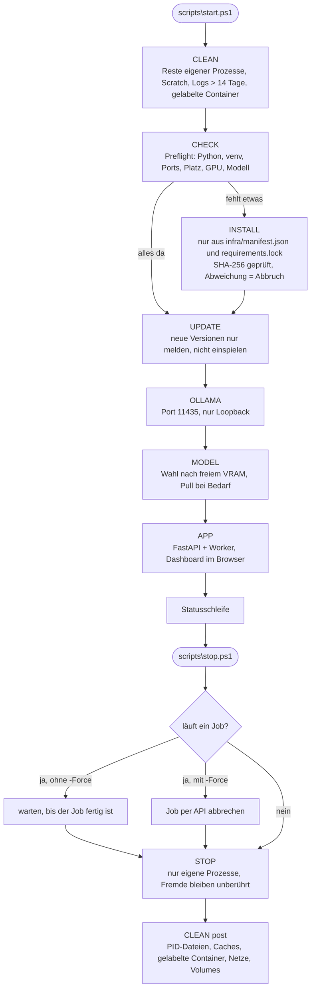
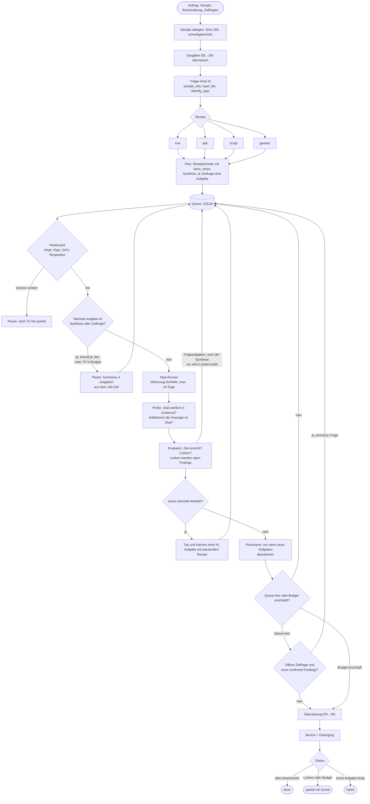
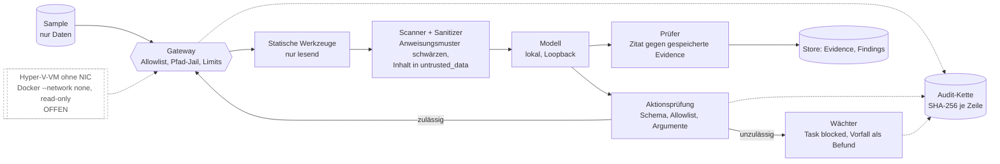
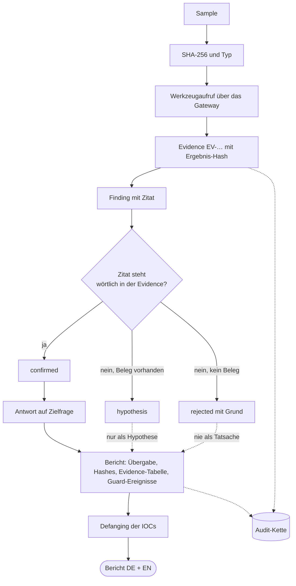

# Workflows auf einen Blick

Vier Diagramme auf hoher Ebene. Sie zeigen nur, was im Code vorhanden ist (Quellen: `scripts/start.ps1`, `scripts/stop.ps1`, `docs/architecture/chain.md`, `orchestrator/*`, `guard/*`, `gateway/*`). Nicht Umgesetztes ist gestrichelt und als **offen** beschriftet. Die Details der Analysekette stehen in [`chain.md`](chain.md), die geplante Methodik je Phase in [`../roadmap.html`](../roadmap.html).

## 1. Start und Stopp

## 2. Lebenszyklus eines Jobs

Synthese und Zielfragen sind normale Aufgaben der Queue mit hoher Prioritätszahl und laufen deshalb zuletzt. Hypothesen und offene Punkte erreichen spätere Analyseaufgaben, Evaluator und Planer als Datenblock, aber keine Zielfrage. Die Regeln stehen in [ADR-0007](../adr/0007-iterativer-analyseprozess.md).

## 3. Schutzschichten um das Modell

## 4. Datenfluss vom Sample zum Bericht

## Nicht Teil dieser Diagramme (offen)

Ghidra und Disassembler-Werkzeuge, Docker-Werkzeug-Images, Wissensdatenbank, Obsidian-Vault, Hyper-V-Isolation und die dynamische Analyse ([ADR-0005](../adr/0005-dynamische-analyse.md), Entwurf, braucht Freigabe).